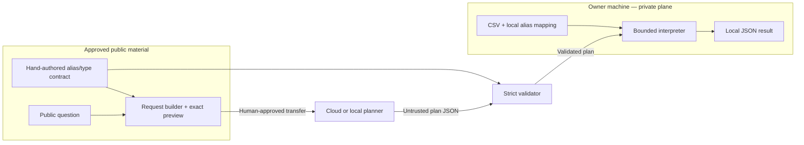
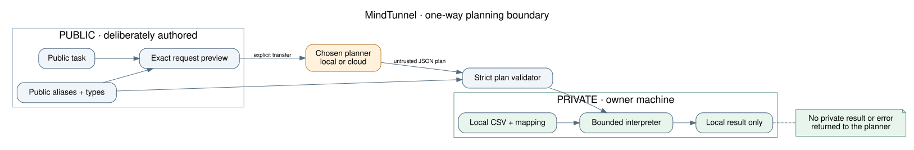

# Architecture and data flow

## Core abstraction
`PublicContract + public task -> Plan IR -> validated local execution -> private result`. Two separate CLI commands and trust domains. The request builder never accepts a dataset path, local mapping or result. A human can manually transfer the reviewed request to any planner. The offline executor accepts local inputs and plan; it has no provider code, network calls or generic code execution. The reference implementation is an ordinary process, not an OS sandbox. Future remote planner worker must have OS-level separate privileges and no private mounts; executor must have network denied in a production deployment.

**No arrow from private plane to planner.** This is the property, not merely a prompt instruction. The owner must not give the cloud coding agent access to real `private/` files or terminal results. `gitignore` is not a sandbox.

## Contract v1 (bootstrap)
Public JSON: `{version: 1, fields: [{id: "category", type: "string"}, {id: "amount_cents", type: "integer"}]}`. Field IDs match ASCII `[a-z][a-z0-9_]{0,31}`; max 16; reject duplicates, reserved special aliases `value` and `count`. No descriptions, inferred data or statistics by default. Mapping (private): exact dictionary `alias -> CSV header`. A manually created mapping is read only by executor. Contract hash uses canonical UTF-8 JSON with sorted object keys, separators `,`/`:`, no ASCII escaping; array order retained. Both sides verify SHA-256 before execution. This binds schema identity, not user approval or plan origin.

Plan v1 JSON has exactly `version`, `contract_sha256`, `group_by` (null or one string field), `aggregate` (`{op:"count",field:null}` or `{op:"sum",field:"amount_cents"}`), `filter` (null or `{field:"category",eq:"food"}`; literal type matches alias). No paths, shell, SQL, URLs, scripts, loops, network or callback arguments. Plan strings/literals are untrusted. Supported type integer = signed 64-bit input; sums are exact Python integers. CSV header mapping explicitly selected; no writes to source. Output schema: `{version:1, rows:[{group:..., value:...}]}` ordered lexicographically by string group; ungrouped aggregate has group null. Empty ungrouped count/sum=0; empty grouped rows empty. Max file 8 MiB, 50,000 rows, 200 output groups, cell length 4096, public task 2000 chars, JSON 64 KiB. Reject, never silently truncate. Limits are not calibrated for production.

## Commands
- `python -m mindtunnel.cli request --contract examples/contract.json --task 'Sum amount_cents by category'` prints only eligible public request + plan format. User manually transfers only if safe. No network, data inspection or auto approval.
- `python -m mindtunnel.cli run --contract ... --mapping ... --data ... --plan ... --out work/result.json` validates then executes locally, creates output exclusively (no overwrite), prints generic success. Errors shown as generic code, not values. Directory must already exist. Do not run on private data through a cloud-connected agent. No output export tool.
- `make demo` uses synthetic inputs and inspects output. No provider call.

## Future MVP interfaces
`PlannerClient.generate(ApprovedRequest)->UntrustedPlan`; separate process, exact request bytes reviewed and hash-bound to explicit one-time approval, destination/model shown, no implicit context, tools, retrieval, retries with private errors, or access to private filesystem. Provider adapter is opt-in, test with fake HTTP capture; fail closed if offline/approval mismatch. A user can continue to use manual transport. `PlanValidator.validate(contract, bytes)->ValidatedPlan` only; `Executor.execute(validated, local_input)->Result`; `ResultSink.write_local(result)` only. Bind validated plan to a contract; avoid accepting mutated object after validation. Use JSON schemas plus code-level semantic validation (strict JSON parser; no duplicate keys or coercion). Future plan operations: projection, filtered aggregation, sorting/limits and safe computed fields after explicit semantics and tests. Do not introduce unrestricted SQL.

## Storage / operations
No daemon or persistent DB. Private inputs/results should be outside the checkout, with owner-only permissions and disk encryption where available. Audit logs after MVP record only request/plan hash, operation category, version and status, not task, paths, values, counts, result hashes or raw provider errors by default; hashes of low-entropy secrets can leak. Explicit user-directed local export is outside the planner. Local dependencies are reviewed and pinned before releases.

## Rendered diagram

Graphviz source: `diagrams/architecture.dot`; the Mermaid source above is also editable.
